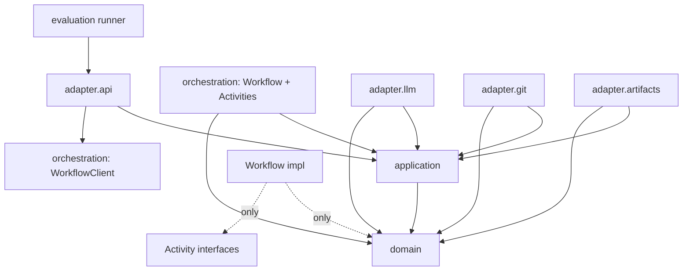
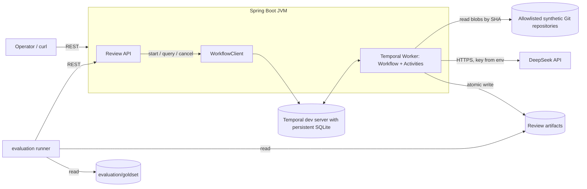
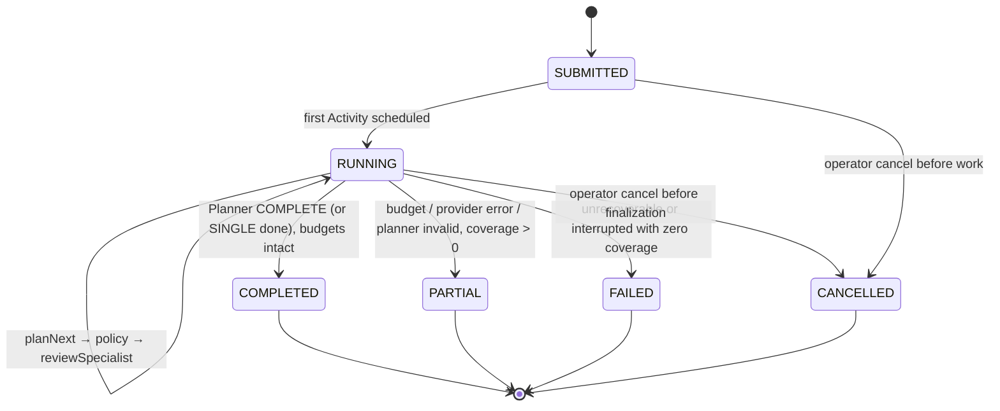

# Architecture Spine — AI Code Review Team

## Design Paradigm

**Hexagonal (ports & adapters)** inside one Spring Boot executable and one Maven module (docs ADR-001). The **Temporal Workflow is the application's orchestrator**. It holds the review state machine and enforces every limit. Everything with an effect (LLM, JGit, files, clock) lives behind a port and runs inside an Activity or the API.

Layers, relative to a root package chosen at bootstrap:

| Package | Holds | May depend on |
| --- | --- | --- |
| `domain` | Records, enums, pure policies (budget, plan-decision policy, topic normalization, reasons, coverage math) | JDK only |
| `application` | Ports (`RepositoryReadPort`, `PlannerPort`, `SpecialistPort`, `ArtifactStorePort`), `FindingValidator`, deduper, report assembler, submission service | `domain` |
| `orchestration` | `CodeReviewWorkflow` + impl, Activity interfaces + impls, Temporal client/worker config | `domain`, `application` (impls only: the Workflow impl sees `domain` + Activity interfaces) |
| `adapter.api` | REST controllers, DTO mapping | `application`, `orchestration` (client side only) |
| `adapter.llm` | LangChain4j models, prompts, tool loop, error classification | `application`, `domain` |
| `adapter.git` | JGit reader, `ContentPolicy`, tool objects | `application`, `domain` |
| `adapter.artifacts` | Filesystem artifact store, Markdown/JSON writers | `application`, `domain` |
| `evaluation` | Trial runner, report matcher, metrics | Public REST and published artifacts for the runner. Published artifacts and goldset for the scorer |



## Invariants & Rules

### AD-1 — Layering is enforced by a test, not by convention

- **Binds:** all
- **Prevents:** framework types (Spring, Temporal, LangChain4j, JGit, Jackson annotations) leaking into `domain`; the Workflow impl importing adapters.
- **Rule:** Use this spine to resolve the v1 PRD boundaries where baseline design sketches differ. Honor the engineering constraints in `CLAUDE.md`. Update the affected contract and ADR when implementation changes a boundary. The dependency table above is binding. An ArchUnit test in the build fails on any violation `[ASSUMPTION: ArchUnit as the enforcement tool]`. `domain` imports nothing outside the JDK.

### AD-2 — One Workflow per review; the Workflow body is effect-free `[ADOPTED]`

- **Binds:** FR-1–5, FR-20, FR-21, NFR-2, NFR-6
- **Prevents:** a second state machine (a DB, LangChain4j `AgenticScope`, a nested supervisor), and replay nondeterminism.
- **Rule:** There is exactly one `CodeReviewWorkflow` type, with `workflowId = "review-" + reviewId`. Workflow code performs no LLM, JGit, file, network, `System`-clock, random or UUID calls. It reads time only through `Workflow.currentTimeMillis()` and timers. Ids are derived deterministically (for example, `review-42-inv-1`). Run lifecycle state lives only in Temporal: no application DB.

### AD-3 — The Activity set and boundary are fixed

- **Binds:** FR-9, FR-10, FR-13, FR-14, FR-18, FR-20
- **Prevents:** Activities with other granularities (per LLM call, whole team in one) drifting in feature by feature.
- **Rule:**
  - The Workflow schedules `planNext(PlannerInput)`, `reviewSpecialist(AgentTask)` and `validateAndReport(ReportInput)`. Submission preflight uses the repository port to check the synthetic allowlist entry, full reachable commit IDs and a nonempty bounded diff. Require BASE to be an ancestor of HEAD in v1 `[ASSUMPTION]`. Freeze the content policy, budget and preflight change units (AD-15) into the Workflow input.
  - Work Activities follow AD-7 and AD-16. Reporting has a 60 s Start-to-Close, a 4 min Schedule-to-Close and at most four attempts with 2–30 s exponential backoff `[ASSUMPTION]`. Retry transient filesystem failures. Fail permanently on invalid report input or a conflicting published manifest.


### AD-4 — Single-agent mode is a branch of the same Workflow

- **Binds:** FR-13, FR-23
- **Prevents:** a second workflow or code path with different budgets, tools or validation, which would make the comparison unfair.
- **Rule:** `ReviewMode.SINGLE_AGENT` skips `planNext` and runs exactly one `reviewSpecialist` with role `SINGLE`, under the same `ReviewBudget`, tools, validator and report Activity `[ASSUMPTION]`. The Planner's allowed roles are `{CORRECTNESS, SECURITY, PERFORMANCE}`. `SINGLE` is never plannable.

### AD-5 — Planner output is a proposal; the Workflow decides

- **Binds:** FR-9, FR-11, FR-25
- **Prevents:** the Planner choosing unknown roles, changing budgets or looping, and each feature validating decisions differently.
- **Rule:**
  - The pure domain policy validates the action, role and required fields in the Workflow. Topic keys use NFKC, lowercase with `Locale.ROOT`, collapse runs outside ASCII letters and digits to hyphens, then trim hyphens. Limit keys to 64 characters `[ASSUMPTION]`.
  - Keep a bounded decision trail in order, with role, task, topic, rationale and disposition. Unknown roles, forbidden actions, missing fields and malformed output after repair count toward three consecutive invalid decisions `[ASSUMPTION]`. A valid decision resets the streak. Three invalid decisions stop with `PLANNER_INVALID`.
  - A valid proposal whose topic or delegation allowance is exhausted stops with `BUDGET_TOPIC` or `BUDGET_DELEGATIONS` and is recorded as rejected. After the last permitted delegation the Planner may close with COMPLETE if its own slice is available. A further DELEGATE stops the run. Other run limits are checked before any call.


### AD-6 — Malformed model output is a value, not an exception

- **Binds:** FR-17, FR-26
- **Prevents:** Temporal retrying (and re-billing) a call whose output was merely unparseable.
- **Rule:** Inside the Activity, malformed structured output gets at most one repair request. After that the Activity *returns* `PlanOutcome.Invalid` or an `AgentResult` with a recorded rejection. It never throws for bad output.

### AD-7 — One retry layer, classified

- **Binds:** FR-26, NFR-2
- **Prevents:** stacked HTTP-client and Activity retries multiplying spend; retrying permanent errors.
- **Rule:**
  - Disable model-client and transport automatic retries. Temporal is the only work Activity retry layer. The LLM adapter maps rate limits, transient server/transport errors and timeouts to retryable errors. Invalid/authentication requests and policy refusals map to permanent errors. Activity implementations translate these classifications to Temporal failures and keep SDK types out of the adapter.
  - Allow at most three attempts with exponential backoff from 2 s to 30 s `[ASSUMPTION]`. Use a Start-to-Close of at most 3 min and Schedule-to-Close of at most 10 min, both clamped to the remaining elapsed budget at schedule time `[ASSUMPTION]`. AD-8 bounds the entire invocation across those attempts.
  - Exhausted provider retries end the loop with `PROVIDER_ERROR`. Use AD-15 for status. Keep attempt counts and separate measured usage from amounts reserved for unknown attempts.


### AD-8 — Budgets are enforced in Java at two levels

- **Binds:** FR-11, NFR-5, OQ-6
- **Prevents:** limits that live only in prompts; a single invocation blowing the run ceiling; reading the wall clock in the Workflow.
- **Rule:**
  - The API snapshots run limits, model parameters and the dated price basis. The Workflow owns the aggregate of estimated USD in integer microdollars, input and output tokens and tool calls. Before scheduling, reserve the full invocation allocation and count the delegation once. Planner allocations include zero tools. Both modes share the run ceilings and a 30-call tool pool `[ASSUMPTION]`.
  - Divide each invocation's token, tool and cost allocations into explicit per-attempt shares whose sum stays within the allocation. The Activity selects its share by Temporal attempt number. Split integer allocations 50%, 30% and 20% across three attempts `[ASSUMPTION]`. Round each share down and give leftover units to the first attempt. Freeze the shares in the scheduled input. Clamp specialist tool allocations to the unused run pool before splitting. Check projected input, permitted output, estimated charge and deadline before each provider request, including repair. The adapter must use a conservative estimate that includes prompt and tool history. Check the tool allowance before each dispatch. Reject configurations with unusable shares in bootstrap tests.
  - The Workflow charges returned usage for successful or conclusively measured attempts and the full share for attempted work with missing usage. When it cannot determine the number of attempts, charge the whole invocation allocation and label unknown usage. Release provably unused reservations. Estimates and observed provider usage remain distinct.
  - A stop at the current attempt share ends review with its corresponding `BUDGET_*` reason under AD-15. Race work against a deterministic Workflow timer. Cancel outstanding work on expiry and finalize with `BUDGET_ELAPSED`. Use the elapsed budget plus 5 min as the server execution-timeout backstop `[ASSUMPTION]`.
  - Defaults `[ASSUMPTION]`: 15 min, 6 delegations, 2 per topic, 12 tool calls per specialist invocation, USD 0.50 per run. Allocate up to USD 0.02 per Planner, USD 0.06 per specialist and USD 0.50 to the SINGLE invocation. A seven-Planner/six-specialist sequence reserves at most USD 0.50 including retries. Require explicit run and role token allocations in the bootstrap configuration and validate that the planned sequence fits.


### AD-9 — Tools are snapshot-bound, read-only, with one policy chokepoint

- **Binds:** FR-6, FR-7, FR-8, NFR-1
- **Prevents:** shared mutable tool state across reviews; a new tool bypassing path, secret or goldset rules; drift in tool names.
- **Rule:**
  - Tool objects are created per invocation, bound to an immutable `ReviewSnapshot(repositoryId, baseSha, headSha)` with full 40-hex SHAs.
  - JGit reads blobs by commit, never the working tree.
  - Canonical tool names equal the `RepositoryReadPort` method names: `listChangedFiles`, `getDiff`, `readFile`, `searchCode`, `findRelatedTests`, `getBuildMetadata`.
  - Every result passes through `ContentPolicy`, which does path canonicalization, refusal of symlinks, out-of-policy submodules, binaries and oversized content, secret redaction, and deny-globs. A refusal is returned to the model as a tool error string, never thrown.
  - No tool can write, execute, check out or reach the network.
  - Use one-based inclusive lines and Unicode code points for character limits. Keep line positions through redaction. Limits `[ASSUMPTION]`:

    | Tool or input | Limit |
    | --- | --- |
    | `readFile` | ≤ 200 lines |
    | `searchCode` | ≤ 20 hits |
    | `getDiff` | ≤ 400 lines per file |
    | Any tool result | ≤ 16 000 chars |
    | Submission | ≤ 20 changed files, ≤ 1 500 changed lines |

### AD-10 — The goldset is physically outside every reviewable repository

- **Binds:** FR-8, FR-22
- **Prevents:** evaluation contamination through tools or prompts.
- **Rule:** The goldset lives under the project's `evaluation/` data directory, never inside a fixture Git repository. Only the `evaluation` package reads it. `ContentPolicy` also denies `**/goldset*` as defense in depth.

### AD-11 — Evidence validation has one owner and runs once

- **Binds:** FR-14, FR-15, FR-16, SM-4
- **Prevents:** two validators with different matching rules; LLM-claimed locations reaching findings unchecked.
- **Rule:**
  - `FindingValidator` in `application` executes inside `validateAndReport`. Require a canonical path, the full pinned HEAD SHA and valid one-based inclusive line bounds before matching. Its restricted port sees the same denied and redacted HEAD content as model tools, with limits sized for validation. Denied paths, unavailable source, invalid bounds and non-HEAD citations yield `INVALID_EVIDENCE`. Normalize line endings and horizontal whitespace per line, preserving line positions. `SOURCE_VERIFIED` requires an exact normalized contiguous match inside the cited range. A full match only outside it is shifted and invalid. An in-range contiguous match of at least half the nonblank quote lines with no in-range full match is `NEEDS_REVIEW` `[ASSUMPTION]`. Other mismatches are invalid. This classification attests to source only.
  - Preserve each candidate disposition and its reason in the report. Label verified locations `CHANGED_LINE` if they overlap a changed HEAD line and `CONTEXT_LINE` otherwise. A candidate must supply at least one reference with a nonblank quote and every supplied reference must verify before it becomes a finding, with severity explicitly model-assigned.
  - Merge candidates using normalized issue title and overlapping verified HEAD location, independent of role and category. Preserve each invocation, role and candidate index in provenance. Use stable invocation order to select display title and category, highest model severity, and stable severity/path/line/title order to number findings.


### AD-12 — Temporal history carries only small, bounded records

- **Binds:** FR-12, NFR-2, NFR-3
- **Prevents:** payload or history-size failures; full transcripts or source in history.
- **Rule:**
  - Use bounded plain records with explicit enum discriminants for variants across Temporal. Use the SDK Jackson 2 converter for Temporal and the pinned Spring Boot Jackson 3 mapper for REST and report serialization `[ASSUMPTION]`. Test round-trips with the resolved SDK converter and test report fixtures independently.
  - Keep at most 20 candidates per invocation and 15 lines/1,024 UTF-8 bytes per quote `[ASSUMPTION]`. Enforce caps at the Activity boundary. Record bounded dispositions and overflow counts for rejected input rather than silently truncating evidence. Keep only sanitized, policy-checked quotes in history.
  - The Workflow builds the ledger in invocation order from structured scope, coverage, stop reason and bounded sanitized observations. Limit the ledger to 4,000 Unicode code points `[ASSUMPTION]`. Treat its free text as untrusted context. Test worst-case serialized `ReportInput` against a 512 KiB limit `[ASSUMPTION]`, including all records and audit metadata.


### AD-13 — Artifacts are deterministic files with a single writer

- **Binds:** FR-18, FR-19, NFR-3, OQ-4
- **Prevents:** corrupt or duplicate reports after a lost ack; nondeterministic content across retries.
- **Rule:**
  - Only `validateAndReport` publishes to `output/reviews/{reviewId}/`. The Workflow supplies the terminal disposition, timestamps, pinned configuration, decision and usage ledgers, coverage and bounded candidates. The Activity validates and assembles without changing the review disposition.
  - Stage all files in an attempt-private directory on the output filesystem. Write the complete report set in an immutable attempt directory. Publish its prepared manifest through one same-filesystem hard-link creation to the public manifest name `[ASSUMPTION]`. An existing name wins. Check filesystem support at startup and exercise this guarantee with overlapping attempts. The manifest includes review, Workflow and run IDs, request hash, status, reasons, coverage, snapshot, fixture identity where applicable, model settings, budget, prompt versions, price basis, limitations, schema version and report digests. Readers expose links only for a complete matching manifest. Record a digest of the frozen report input. Retries verify the existing manifest and report digests and return the existing publication for that input. Reject conflicting input.
  - Return relative paths plus SHA-256 digests. Include reasons, coverage and usage in minimal FAILED and CANCELLED reports. If publication exhausts retries, preserve the frozen review disposition and expose a separate report availability error with no links. A late valid publication may restore links for that same disposition and request identity. Test status across a reporting timeout, late publication and history expiry. The report endpoint returns `409 review-running` while work or finalization runs, `410 report-unavailable` for known missing or corrupt artifacts, and `404` for unknown IDs `[ASSUMPTION]`.


### AD-14 — Idempotent submission lives in Temporal, not a DB

- **Binds:** FR-2, FR-3, NFR-6
- **Prevents:** duplicate runs; conflict semantics needing an application store.
- **Rule:**
  - Canonicalize repository ID, lowercase full object IDs and review mode in a versioned, fixed-order UTF-8 encoding. Exclude the review ID and runtime configuration from the request hash. Store the SHA-256 in the Temporal memo and manifest.
  - Recognize a published manifest first, then describe retained executions. For a new start explicitly reject closed-ID reuse and fail on an open-ID conflict. On a start conflict describe the winner and compare hashes. A matching hash returns `200` with the existing review, a mismatch returns `409`, and a fresh start returns `202` with `Location`. Propagate transient lookup failures as unavailable. Treat only confirmed absence as eligible for a fresh start.
  - Query open executions, read the result of closed executions and use the manifest for published reviews after history retention. On abnormal server close, use a verified manifest for the same execution if available. Otherwise expose `FAILED` with `INTERNAL_ERROR` and unknown coverage. That fallback can resolve to the frozen outcome if its valid publication later appears. When a normal Temporal result exists, require the manifest to match its run identity and disposition before exposing links.
  - Provision and verify a 30-day development namespace retention before accepting submissions `[ASSUMPTION]`. Published IDs remain pinned while the manifest survives. An unpublished ID whose Temporal history expired can be reused. This bounds FR-2 to retained state or a published manifest `[ASSUMPTION]`.


### AD-15 — One vocabulary for terminal reasons and coverage

- **Binds:** FR-5, FR-11, FR-18, FR-25
- **Prevents:** three names for one concept (`reasons[]` / `completionReasons` / `limitations`); "no issues found" on partial coverage.
- **Rule:**
  - Status, report and manifest use `reasons: List<TerminalReason{code, detail}>`. Codes are `BUDGET_DELEGATIONS`, `BUDGET_TOPIC`, `BUDGET_TOOL_CALLS`, `BUDGET_TOKENS`, `BUDGET_COST`, `BUDGET_ELAPSED`, `PROVIDER_ERROR`, `PLANNER_INVALID`, `CANCELLED_BY_OPERATOR` and `INTERNAL_ERROR`. Limitations are a separate list.
  - Preflight supplies canonical change IDs, old and new paths and changed ranges on each commit side. Freeze the same diff and rename policy for all reads. Identify coverage by change ID, BASE or HEAD and one-based line number. Track descriptor-only changes as a separate unit kind. A changed line is one added HEAD line or one deleted BASE line. Tool wrappers record only diff units and file ranges actually delivered to the model after policy and truncation. Head file reads can cover HEAD units. Delivered diff hunks can cover either side. A file with no textual change units requires its complete change descriptor. Denied units remain uncovered.
  - The Workflow uses the pure domain policy to union observed units from recorded Activity outcomes. A file is fully covered when all its change units are covered. Report files read, files fully covered and total changed files, plus covered and total changed lines and attempted and completed roles. A role is attempted when dispatched and completed when a recorded invocation returns normal completion. Keep unavailable reads out of the numerator and disclose that limitation. Evaluation consumes these same counts.
  - A budget, provider or Planner stop yields `PARTIAL` with at least one observed changed unit, including a descriptor-only change and `FAILED` otherwise `[ASSUMPTION]`. A normal stop yields `COMPLETED`. An accepted operator cancellation before finalization yields `CANCELLED`. Use “no issues found” only when the review completed, both coverage measures are full, and no findings or unverified candidates remain.


### AD-16 — Cancellation is heartbeat-bounded

- **Binds:** FR-4
- **Prevents:** a cancelled run still spending, or ending `COMPLETED`.
- **Rule:**
  - Work Activities emit heartbeats throughout blocking provider requests and tool calls. Use a 10 s heartbeat ticker, 30 s heartbeat timeout and SDK heartbeat throttling capped at 10 s `[ASSUMPTION]`. Cap each provider request at 60 s or the remaining attempt time, whichever is shorter. On a cancellation notification stop dispatching work and abort the request when supported. A provider may finish an already accepted request.
  - Use `WAIT_CANCELLATION_COMPLETED` for work Activities. Wait up to 30 s from a stop request for acknowledgment `[ASSUMPTION]`, then finalize and reserve unknown usage under AD-8. Accepted operator cancellation wins over ordinary completion or budget stop until finalization freezes the disposition. The Workflow finalizes in a detached cancellation scope after accepted operator cancellation. The API requests cancellation through a synchronous Workflow Update handler that accepts it only while the review is active. Freeze the terminal disposition at the start of finalization so a late cancel cannot race report publication. Test cancellation during a blocking call and after the disposition is frozen.


### AD-17 — Workflow changes are versioned and replay-tested

- **Binds:** FR-20, FR-21, NFR-2
- **Prevents:** a code change breaking in-flight or recorded runs.
- **Rule:** Record single-agent history at FEATURE-006 and multi-agent history at FEATURE-010. After the first recorded history, guard command-sequence changes with `Workflow.getVersion` and replay prior histories with `WorkflowReplayer`. FEATURE-012 kills and restarts the application against the persistent dev server and asserts request counts from an independent HTTP stub. FEATURE-012 also verifies bounded rate-limit retry, malformed output, invalid line references, budget stops, cancellation and duplicate publication.

### AD-18 — The LLM adapter owns prompts, the privacy gate and usage capture

- **Binds:** FR-10, FR-19, NFR-4, NFR-7
- **Prevents:** unversioned prompts; non-synthetic code reaching DeepSeek; usage recorded differently per role.
- **Rule:**
  - Version prompts as classpath resources (for example, `prompts/correctness/v1.md`). Freeze the prompt version map at submission and pin model settings and prompt versions per invocation and record them in the manifest. Use provider JSON object mode with local schema validation for Planner responses, subject to the FEATURE-002 wire-level check.
  - Enforce the synthetic-only policy again before any model call. Send only policy-checked bounded inputs. Keep provider built-in tools disabled.
  - Capture available provider usage by attempt with separate estimated cost and explicit unknowns. Both reports include per-invocation and run totals for input tokens, output tokens and estimated cost. Report retry counts where observable and disclose possible repeat provider charges after lost acknowledgments. Record the pricing basis in the manifest. Log review ID, Workflow ID, run ID, invocation ID and attempt with no raw source, transcripts or secrets.


### AD-19 — Fixtures are reproducible Git repos built by script

- **Binds:** FR-22, FR-23, OQ-7, NFR-3
- **Prevents:** SHAs changing between machines or runs; early slices blocked on the full fixture.
- **Rule:** Fixture repositories are generated by a committed script from committed sources, with a fixed author, committer and dates and tags for BASE and HEAD, so the objects remain reachable and the SHAs are reproducible `[ASSUMPTION]`. A tiny fixture for early slices and tests is built the same way. The evaluation scorer consumes artifacts and the goldset. Trial submission uses the public API (AD-20).

### AD-20 — Evaluation runs against the public review contract

- **Binds:** FR-22–24, NFR-3
- **Prevents:** mode-specific scoring, irreproducible comparisons and loss of trial evidence.
- **Rule:** Submit 3–5 paired single-agent and multi-agent trials through REST with independent review IDs and a shared experiment manifest. Pin fixture SHAs, provider settings, prompt versions and total budgets. Keep all trial reports and manifests, including incomplete trials, in the experiment results directory. Publish the comparative summary and evidence references even for negative or inconclusive outcomes. Judge root cause, location and plausible failure scenario against the goldset with mode hidden where possible. Report recall against the nine seeded defects, semantic precision over shown findings, false positives per run, coverage, latency, estimated cost, partial and failed run counts and variability. Measure Planner decision quality from the recorded counts of accepted, rejected, repeated-topic and terminal decisions. Include the cost/quality frontier and disclose effective first-attempt allowances for both modes.

## Consistency Conventions

| Concern | Convention |
| --- | --- |
| Ids | `reviewId`: caller-supplied `[A-Za-z0-9-]{1,64}` or a server UUID. `workflowId = review-{reviewId}`. invocation IDs append `-inv-` and a one-based sequence to the review ID. Findings `F-001…` in deterministic order. SHAs are full 40-hex lowercase. |
| Naming | Records are nouns (`AgentTask`, `PlanOutcome`). Ports end in `Port`. Activity interfaces end in `Activities`. Tool names follow AD-9. |
| Time | Domain records carry `Instant` produced from Workflow time. Activities never stamp report content with their own clock. |
| Errors (REST) | RFC 9457 `application/problem+json` with a stable `type` code (`unknown-repository`, `unknown-sha`, `diff-too-large`, `review-conflict`). |
| Errors (internal) | Permanent errors → non-retryable `ApplicationFailure` with the type = exception simple name (AD-7). Tool refusals → returned strings (AD-9). Bad model output → returned values (AD-6). |
| Serialization | Jackson. Records only in Activity payloads and reports. `schemaVersion` on report and manifest, starting at `"1"`. Enums serialized by name. |
| Config | One typed `@ConfigurationProperties` tree under `review.*`: budgets, limits, allowlist (`id`, `path`, `synthetic`), model, price table, output dir. Secrets only from env (`DEEPSEEK_API_KEY`). |
| Logging | SLF4J structured. MDC keys per AD-18. No source text or prompts at INFO. |
| Testing | Automated tests use a scripted fake model or local HTTP stub for provider wire behavior. Workflow tests use Temporal `TestWorkflowEnvironment`. Use the persistent local Temporal server for worker-restart and replay experiments. Live provider tests are opt-in and excluded from CI. |

## Stack

| Name | Version |
| --- | --- |
| Java (Temurin) | 25 |
| Maven | 3.10.1 |
| Spring Boot | 4.1.3 |
| Temporal Java SDK (`temporal-sdk`, `temporal-testing`, via `temporal-bom`) | 1.41.1 |
| Temporal CLI dev server | 1.10.0, run with `--db-filename` |
| LangChain4j (`langchain4j`, `langchain4j-open-ai`, via `langchain4j-bom`) | 1.24.0 |
| Eclipse JGit | 7.8.1.202611041320-r |
| ArchUnit (`archunit-junit5`) | 1.5.1 |
| LLM | DeepSeek `deepseek-flash`, non-thinking, OpenAI-compatible endpoint (FEATURE-002 spike confirms) |

Version evidence is recorded in [the currency review](reviews/review-currency.md). FEATURE-001 must resolve the build and compile on Java 25. FEATURE-002 confirms thinking disabled, request token limits, JSON object mode and blank or truncated output at the wire boundary.

Integration choices: Temporal is wired with plain SDK beans (`WorkflowServiceStubs`, `WorkflowClient`, `WorkerFactory`), not the Spring Boot starter. LangChain4j models are built programmatically, without its Spring starters. `langchain4j-agentic` is not used. `[ASSUMPTION]`

## Structural Seed





Environment: local only. One JVM runs the API and the Worker. The Temporal CLI dev server keeps persistent state in a file. Artifacts go to local disk. CI runs `mvn verify` with the fake model, no secrets and no Temporal server (the test environment is in-process).

```text
{root}/
  pom.xml
  src/main/java/{rootpkg}/
    domain/  application/  orchestration/
    adapter/api/  adapter/llm/  adapter/git/  adapter/artifacts/
    evaluation/
  src/main/resources/prompts/correctness/v1.md
  src/test/resources/histories/        # replay histories (AD-17)
  fixtures/{name}/                     # fixture sources + build script (AD-19)
  evaluation/goldset/                  # goldset, outside any fixture repo (AD-10)
  output/reviews/{reviewId}/           # gitignored artifacts (AD-13)
```

## Capability → Architecture Map

| Capability / Area | Lives in | Governed by |
| --- | --- | --- |
| FR-1 Submit, preflight | `adapter.api`, `application` submission service, `adapter.git` | AD-3, AD-9, AD-14 |
| FR-2 Idempotent identity | `adapter.api` + Workflow memo | AD-14 |
| FR-3 Status/progress | Workflow `@QueryMethod` | AD-2, AD-14, AD-15 |
| FR-4 Cancel | `orchestration` | AD-16 |
| FR-5 Honest terminal state | `domain` reasons/coverage | AD-15 |
| FR-6–8 Pinned read-only tools, policy, goldset | `adapter.git` | AD-9, AD-10 |
| FR-9 Planner decisions | `adapter.llm` + `domain` policy in Workflow | AD-5, AD-6 |
| FR-10 Specialist review | `adapter.llm` via `reviewSpecialist` | AD-3, AD-9, AD-18 |
| FR-11 Budgets | `domain` budget + Workflow + Activity slice | AD-8 |
| FR-12 Bounded context | Workflow ledger | AD-12 |
| FR-13 Single-agent mode | Workflow branch | AD-4 |
| FR-14–16 Validation, audit, dedupe | `application` validator in `validateAndReport` | AD-11 |
| FR-17 Malformed output | `adapter.llm` | AD-6 |
| FR-18, FR-19, FR-25 Reports, usage, decision trail | `application` assembler + `adapter.artifacts` | AD-13, AD-15, AD-18 |
| FR-20, FR-21 Durable recovery, replay | `orchestration` | AD-2, AD-3, AD-17 |
| FR-26 Provider errors | `adapter.llm` + Activity RetryPolicy | AD-7 |
| FR-22–24 Fixture, experiment, publish | `fixtures/`, `evaluation` | AD-4, AD-10, AD-19, AD-20 |
| NFR-1 Security | `adapter.git`, tool set | AD-9 |
| NFR-4 Privacy | `adapter.llm` gate, allowlist | AD-18 |
| NFR-6 No app DB | — | AD-2, AD-14 |
| NFR-7 Observability | `adapter.llm`, logging | AD-18 |

## Deferred

- **Root Java package and formatter/linter choice:** set once at FEATURE-001. Code owns them afterwards.
- **DeepSeek wire details** (exact thinking-off parameter, strict tool mode, error body shapes): FEATURE-002 spike (PRD OQ-1). It must confirm AD-7's classification before FEATURE-006.
- **`searchCode` / `findRelatedTests` strategy** (JGit tree walk + regex vs. naming heuristics): FEATURE-004 (PRD OQ-3). Revisit if seeded defects are missed for lack of search.
- **Fixture content, hard-to-verify cases and goldset schema:** FEATURE-013 / epics (PRD OQ-5).
- **Exact `PlannerInput`/`AgentTask` field lists:** the code owns them, within AD-8 and AD-12.
- **Per-LLM-call durability, object storage, multi-module split, auth, containerized deployment, report retention/cleanup:** v2 or non-goal (PRD §6, docs ADR-004/009).
- **Real-code approval path:** non-goal in v1. AD-18's gate blocks it.
