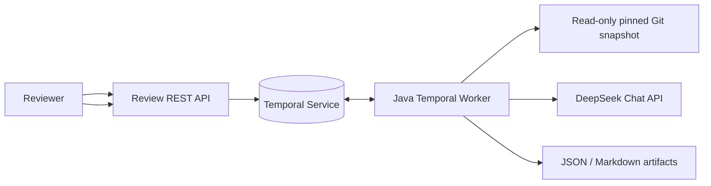
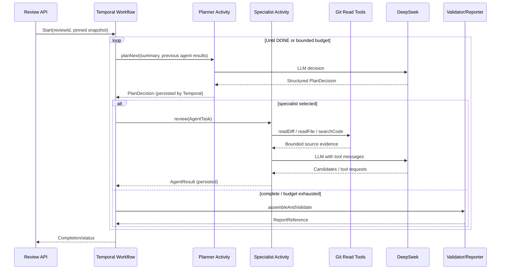

# Architecture — AI Code Review Team

**Status:** Proposed PoC baseline (2026-11-18). **Audience:** implementers, reviewers, Claude Code, Codex.

## Goals and quality attributes

1. Review **a pinned comparison of two Git commits**, not an unbounded or moving working tree.
2. Use **one LLM Planner** and three specialized agents (Correctness, Security, Performance), with dynamically selected delegations.
3. Deliver a typed JSON and human-readable Markdown report with source locations and evidence checks.
4. Restore durable progress after a Java worker crash without rerunning successful Temporal Activities.
5. Make spend, limitations and partial completion explicit; compare a single-agent baseline fairly against multi-agent results.
6. Have zero Git write capability and zero generic shell execution capability.

### Non-goals for v1

- Fixing code, opening GitHub PRs, commenting on PRs or executing arbitrary project code.
- Long-term semantic memory, RAG/vector indexes, a multi-tenant SaaS, production scale or unlimited repositories.
- Exactly-once charges for LLM requests.
- Reliable semantic proof that every finding is a real bug.

## C4-style system context

Actors: **Reviewer** (starts/queries a review), **Developer** (maintains allowlisted local synthetic repo).

External systems: **DeepSeek Chat Completions API** (tokens billed), **Temporal Service** (persistent execution history), **Git repository** (read only).

The app exposes REST endpoints and runs a Temporal Worker. Both may live in the same JVM for the PoC but are logically separate processes/roles and can scale independently later.



## Containers/components

- **Review API**: auth model for PoC (local-only), validates allowlisted repository IDs, commands Temporal Workflow with stable `reviewId`, exposes status/report links; does not perform long synchronous review.
- **Workflow engine**: `CodeReviewWorkflow` controls progress, attempt budgets, iteration counts, decisions and statuses. **No file, HTTP, LLM, random or wall-clock access inside Workflow code.**
- **Planner Activity**: LangChain4j model call returning a typed `PlanDecision` based on bounded review context. Never allowed to pick an unknown agent, extend its budgets, or execute operations directly.
- **Agent Activities**: each specialist is a bounded LangChain4j tool-calling loop. Tools access Git via `RepositoryReadPort` bound to the immutable snapshot; returns `AgentResult` with `FindingCandidate` objects.
- **Evidence Validator**: Java-only, checks path, HEAD SHA, line ranges and cited snippet; semantic correctness is not guaranteed. Dedupe only when justified by normalized issue + location; preserve provenance.
- **Report Assembly**: deterministic JSON + Markdown outputs; writes artifacts under `output/reviews/<reviewId>/`, returns small `ReportReference`.

## Bootstrap package layout

The Spring Boot entry point is `dev.denrzv.codereview.CodeReviewApplication`. The package names below are relative to `dev.denrzv.codereview`.

| Role | Package |
| --- | --- |
| Review API | `adapter.api` |
| State and pure policies | `domain` |
| Services and ports | `application` |
| Planner and specialist model adapters | `adapter.llm` |
| Git and artifact infrastructure | `adapter.git`, `adapter.artifacts` |
| Temporal worker and Activity implementations | `orchestration` |
| Temporal Activity and Workflow contracts | `orchestration.activity`, `orchestration.contract` |
| Temporal Workflow implementations and client operations | `orchestration.workflow`, `orchestration.client` |
| Spring settings and evaluation tools | `config`, `evaluation` |

ArchUnit checks the dependency directions in AD-1. Domain code uses the JDK and other domain types. Application code uses the domain and the JDK. Workflow implementations can use domain types, orchestration contracts, replay-safe JDK types and the Temporal Workflow API. The API uses application services and client-side orchestration. The LLM, Git and artifact adapters implement application ports.

Bootstrap registers an empty review controller and exposes Actuator health on the loopback interface. Future provider and Temporal integration use the plain SDKs under the package boundaries above.

## Durable execution flow



### Recovery boundaries and failure scenarios

| Failure | Expected v1 semantics | Safety requirement |
|---|---|---|
| API process dies after start | Workflow continues if Temporal Service/Worker healthy | Stable ID and conflict handling on retries |
| Worker dies before Activity starts | Activity eventually scheduled/retried | Correct Temporal timeouts |
| Worker dies after specialist result persisted | Replay reuses completed Activity result | No re-billing of completed Activity on replay |
| Worker dies during specialist | Entire Activity may retry, including LLM/tool calls | Bounded retry; cost and duplicate-call visibility |
| DeepSeek 429 / transient 5xx | Classified retry with backoff | Do not stack unbounded HTTP and Temporal retries |
| Invalid schema or hallucinated lines | Reject/flag candidate, not report `VERIFIED` | Deterministic validation; preserve audit |
| Planner loops / delegates repeatedly | Stop with `PARTIAL` plus reason | Max delegations, role repeats, token budget and wall-clock |
| Temporal service data lost | No durability guarantee | Persistent Temporal backing needed for crash experiments |
| Artifact write succeeds but Activity ack lost | Report Activity may replay | Atomic write/rename, stable output path, idempotent result |
| Git repository changes | Continue to read original HEAD commit blobs | Git objects must remain locally available until run completes |

Temporal Activities provide **at-least-once** execution under retry, not transactional/exactly-once side effects. Activity result retention can be affected by configured history/retention. For reproducibility, persist prompt version/model ID, fixture ID, review parameters and a digest of input data separately from large bodies.

### What is and is not durable

**Durable:** successful Activity results; planner delegations/results; workflow completion, retry state and cancellation; bounded summary recorded by Workflow.

**Not stepwise durable in v1:** sub-agent internal tool calls, message history inside a running specialist Activity, partial streamed responses. A crash before Activity completion can replay the whole agent. Full per-LLM/tool-call durability is deferred (see ADR-004).

### Review lifecycle

`SUBMITTED → RUNNING → COMPLETED | PARTIAL | FAILED | CANCELLED`

`PARTIAL` means work stopped with useful but incomplete results (budget, timeout, unavailable provider). It must **not** be reported as a clean code review. Expose `reasons[]` and `coverage` in every report.

### Loop design (conceptual pseudocode)

```java
ReviewState state = initialState(command); // deterministic DTO
while (state.isWithinBudgets() && !state.isDone()) {
    PlanDecision d = plannerActivity.planNext(state.toBoundedContext());
    state = state.record(d);
    if (d.action() == COMPLETE) break;
    AgentTask task = state.toTask(d);
    AgentResult result = switch (d.agent()) {
        case CORRECTNESS -> activities.reviewCorrectness(task);
        case SECURITY -> activities.reviewSecurity(task);
        case PERFORMANCE -> activities.reviewPerformance(task);
    };
    state = state.add(result);
}
ReportReference report = activities.validateAndAssemble(state.toReportInput());
return state.toRunResult(report);
```

The implementation must use actual Temporal `Workflow.newActivityStub` APIs and replay-safe state handling; this is not executable code.

## Persistence and data size

Temporal history stores small **decisions, typed summaries, references and results**, not entire repositories, all source files, or full model transcripts. For large inputs/outputs, use stable content-addressed files (or object storage in v2) and pass identifiers/digests in Activity results. Restrict event/payload sizes and workflow history growth; use Continue-As-New only if future use requires long histories.

Agent scratch context is ephemeral in v1. Use a bounded summary of prior work for new Activity calls. If later replacing Agent Activities with per-call Activities, introduce a durable `AgentTurnState`, message persistence and replay-safe tool dispatch.

## Concurrency, isolation, security

- Bind `ReviewSnapshot(repositoryId, baseSha, headSha)` per review execution. Never store mutable review context in singleton shared tool beans.
- Allowlist repositories; reject arbitrary paths, `..`, symlinks escaping root, submodules pointing outside policy, and oversized or binary content.
- Read **blobs by commit SHA**, not the live working directory.
- Cap lines per read (e.g. 200), max changed files, output tokens, tool requests and total review duration.
- Source comments and diffs can carry prompt injection. Model must never gain shell, filesystem writes, network fetch or secrets.
- Treat external DeepSeek as a data processor; **only synthetic or explicitly approved code** may be submitted.
- Trace IDs: `reviewId`, Temporal `workflowId/runId`, `agentInvocationId`, Activity attempts, model/provider, prompt version, tokens, cost estimate. Do not log API keys or indiscriminate source text.
- DeepSeek transport: evaluate non-thinking mode and Tool Calling compatibility via an explicit smoke test; preserve reasoning metadata if thinking mode is ever enabled.

## Infrastructure for local PoC

- Java 25, Maven, Spring Boot 4.1.x and Temporal Java SDK.
- Temporal local development server with persistent data directory (not ephemeral mode for crash tests).
- Java application with REST API and Worker (same JVM at first).
- DeepSeek API key provided via environment, configurable base URL and model.
- JGit implementation of `RepositoryReadPort`, not arbitrary CLI Git commands.

## Scope extension points

- Temporal Workflow interface decouples orchestration from REST; specialists are callable via Activities.
- `ChatModel` / provider adapter can switch away from DeepSeek.
- `ReportStorePort` could use object storage later.
- Future GitHub PR ingestion and comments require a distinct authorization, approval and permission model.
- Alternative durable granularity (one Activity per LLM/tool call) must be evaluated separately, not silently mixed with v1.

## Official references

- https://docs.temporal.io/develop/java
- https://docs.temporal.io/workflow-definition
- https://docs.temporal.io/encyclopedia/retry-policies
- https://docs.langchain4j.dev/tutorials/agents/
- https://docs.langchain4j.dev/tutorials/tools/
- https://api-docs.deepseek.com/guides/tool_calls/
