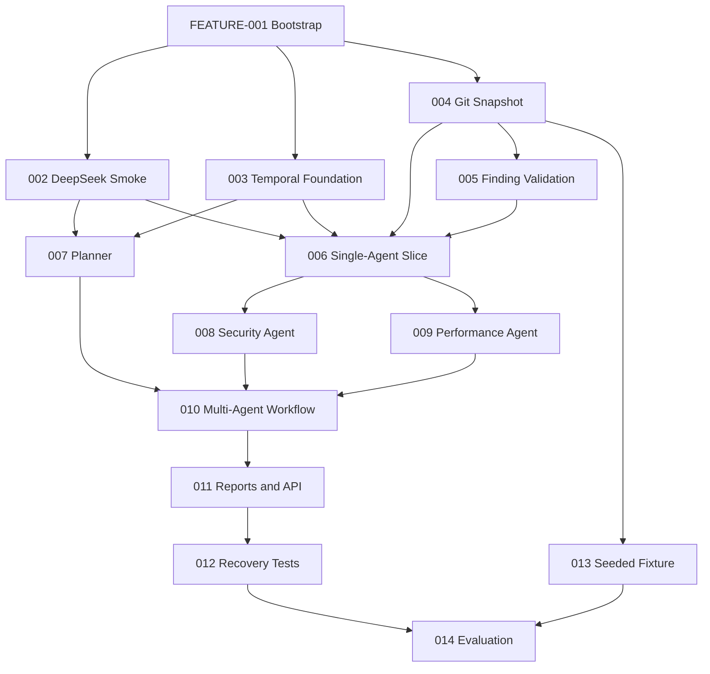

# Implementation Roadmap — GitHub Issues

**Delivery model:** vertical slices, each issue must have measurable acceptance criteria and tests. **Do not implement the whole stack in one PR.** Issues use stable keys `FEATURE-00X` in titles; the GitHub issue number is separate.

## Phases and dependency map

### Work breakdown

| Key | Short title | Primary deliverable | Dependencies |
|---|---|---|---|
| FEATURE-001 | Project Bootstrap | Java 25 / Boot 4 Maven build, structure, CI, config | — |
| FEATURE-002 | DeepSeek Smoke Test | Tested model adapter, tool calls, JSON and error handling | 001 |
| FEATURE-003 | Temporal Foundation | Local persistent Temporal, Java Worker, minimal Workflow | 001 |
| FEATURE-004 | Git Snapshot Reader | JGit allowlisted pinned snapshots, read-only tools | 001 |
| FEATURE-005 | Finding Validation | Typed candidate/finding schema and deterministic validator | 004 |
| FEATURE-006 | Single-Agent Review | End-to-end Correctness review as Temporal Activity | 002, 003, 004, 005 |
| FEATURE-007 | Planner and Budgets | Typed Planner Activity, decision validation and stopping | 002, 003 |
| FEATURE-008 | Security Specialist | Security agent with read-only scope | 006 |
| FEATURE-009 | Performance Specialist | Performance agent with read-only scope | 006 |
| FEATURE-010 | Multi-Agent Workflow | Temporal executes autonomous bounded delegations | 007, 008, 009 |
| FEATURE-011 | Reports and Review API | Async REST/status, idempotent JSON+Markdown reports | 005, 010 |
| FEATURE-012 | Durable Recovery Tests | Worker kill, retry, replay, cancellation and budget tests | 003, 010, 011 |
| FEATURE-013 | Seeded Review Fixture | Synthetic Java repo + independent goldset | 004 |
| FEATURE-014 | Comparative Evaluation | 3–5 trials each, precision/recall/cost/latency analysis | 011, 012, 013 |

## Sprint-like milestones

- **M0 — Baseline:** documentation + issue tracker ready; architecture reviewed.
- **M1 — Technology spike:** FEATURE-001 through FEATURE-005; verify DeepSeek protocol and Temporal baseline before large implementation.
- **M2 — First usable vertical slice:** FEATURE-006 with single agent and evidence validation.
- **M3 — Autonomous team:** FEATURE-007 through FEATURE-010; planner chooses and repeats specialist invocations with hard limits.
- **M4 — Durable product demo:** FEATURE-011 and FEATURE-012; REST, reports and deterministic recovery after Worker restart.
- **M5 — Evidence:** FEATURE-013 and FEATURE-014; evaluate whether multi-agent adds value relative to baseline.

## Common pull request quality bar

- Scope only one FEATURE issue; link it in PR description.
- Prefer simplest implementation that meets existing ADRs.
- New functionality includes unit tests; external LLM E2E tests are optional/manual.
- Avoid unverified assumptions about library APIs; use actual released artifacts and compile/tests.
- Never commit DeepSeek credentials or real proprietary code.
- Every new nontrivial assumption or divergence must update ADRs/risks.
- Expose failures as `PARTIAL` / `FAILED`; no false 'no issues found' on incomplete review.
- Include before/after usage/time metrics when agent behavior changes.

## Manual QA checklist per milestone

- DeepSeek smoke: model-name, tool schema, sequential tool calls, JSON repair and 429/5xx.
- Git tools: no traversal, binary/symlink escapes, diff consistent with HEAD.
- Temporal: no nondeterministic calls inside Workflow; completed Activity not rerun on replay.
- Agent: actual read tool invocations visible, citations refer to HEAD lines.
- Reporting: deterministic outputs, candidate rejection reasons, status and limitations.
- Evaluation: goldset is never accessible to agent tools.

## Code generation guidance

For Claude Code and Codex: implement an issue **only** after reading [Architecture](architecture.md), [ADRs](adr/README.md), [Contracts](contracts.md), [Assumptions](assumptions-and-risks.md), and [Evaluation](evaluation.md). Keep small commits and validation output. Never replace Temporal with in-memory Supervisor or add shell tools as an expedient shortcut.
